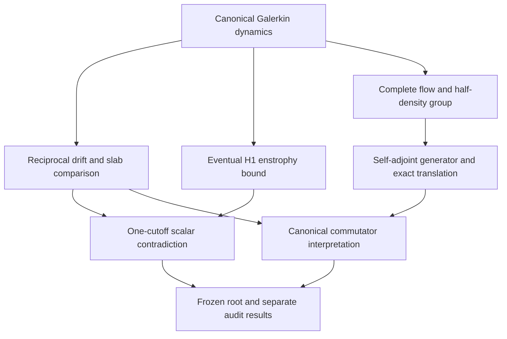

# Probable Lean layout for EHRENFEST-OBSTRUCTION

**Historical B-tier design, version0.3.0; activation updated at0.5.0.** The design retains31 proposed modules and nine logical fast-root blocks, ten full milestone scopes and an optional bundle. Concrete helper splitting is recorded in [COUNT_RECONCILIATION.json](COUNT_RECONCILIATION.json):18 owned sources are active, and the held scalar-root closure has25 owned dependencies. E07 and23 scoped first-layer declarations are accepted; the second layer and all remaining full milestones await their own matching evidence.

The [shortest identified route](FAST_ROUTE.md) supersedes the v0.2 implementation order below: one-cutoff mean-value contradiction and a new H1 error bound avoid hitting/escape and full H2 convergence in the root. [FAST_INTERFACES.lean.txt](FAST_INTERFACES.lean.txt) gives its minimal contracts.

The main architectural refinement is to separate two proofs. The conditional obstruction is a theorem about the literal coefficient drift of the canonical Galerkin family. The full phase-space Heisenberg realization supplies an exact operator interpretation of that drift. The former need not wait for the latter, while completion of the full ten-step workstream requires both.



The final node is the optional All import bundle. Root itself imports only DynamicalRoot and has no operator dependency.

## Ten milestones and their implementation units

Source paths in this table are **historical design names**, under `Material/MethbokeAddon/EhrenfestObstruction/`. The activation register gives actual modules and helper splits. Helpers may be accepted before their enclosing milestone is complete.

| Step | Planned modules | Precise output / gate |
|---|---|---|
| E01 | `Definitions`, `PhaseSpace` | Actual smooth datum, canonical family, literal scalar predicates; real physical finite space and coefficient/physical laws. |
| E02 | `CompleteFlow`, `CanonicalOrbit` | Two-sided smooth flow and exact identification with the existing canonical forward family. |
| E03 | `HalfDensity` | Explicit Jacobian transport, strongly continuous unitary group and invariant test core. |
| E04 | `HilbertCore`, `TransportSymmetry`, `UnitaryGenerator`, `UnitaryResolvent`, `TransportCore` | Dense domain, true adjoint equality and graph-core closure of the differential Hamiltonian. |
| E05 | `TestCore`, `CoreCommutator`, `Heisenberg`, `Localization`, `Translation` | Common-core identity first; then operator domains, Ehrenfest and fixed-cutoff localization. |
| E06 | `ReciprocalDrift`, `ReciprocalCommutator` | Scalar derivative independently; full bounded commutator and canonical rate interpretation later. |
| E07 | `SlabDescent`, `StoppedScalar` | Hit a lower level by `(v 0 - r)/gamma`, with no-hit guard and no assumed hit. |
| E08 | `StoppedFamily` | One fixed smooth datum, thresholds tending to infinity, hits before `1/gamma`. |
| E09 | `ClosedSlab`, `SmoothReference`, `H1Error`, `EventualEnstrophyBound`; retained `FourierTail`, `SobolevProduct`, `GalerkinError`, `SpectralStability` | Actual smooth front gives full-slab convergence and uniform Galerkin enstrophy through a new H2 bootstrap. |
| E10 | `DynamicalRoot`, `Root`; optional `All` collection | Exact conditional implication, separately tracked full translation and semantic equality. |

[MODULE_PLAN.json](MODULE_PLAN.json) is the authoritative planned path/import DAG. The row order above is conceptual; E07 can start independently, and E06's scalar part precedes the full E05 package. E03 reuses the early Hilbert-core part of E04, while E04's complete generator theorem comes after E03. These are acyclic module dependencies, not a circular assumption of self-adjointness. Existing Mathlib/vendor imports will be chosen from the pinned source index when implementation begins; the JSON does not pretend that source anchors are elaborated imports.

## Literal data and the one hypothesis

Use `SmoothDatum := {a : SingularClosure.Field // SingularClosure.SmoothSigmaZero a}`. The canonical family is literally `canonicalGalerkinSolution nu hnu a.val a.property (n+1)`. One viscosity and one datum are fixed before the cutoff index. Reindexing by `n+1` removes the zero-cutoff phase-space case without changing an eventual-cutoff statement.

Write `D=coefficientDissipation`, `Z=coefficientLaplacianSquare`, and `P=coefficientEnstrophyNonlinearPower`. Then

```text
e = D/2,    e' = -nu*Z-P,
V = (1+e/eStar)^(-1),
c = (nu*Z+P)/(eStar*(1+e/eStar)^2).
```

The scalar `c` is this rational coefficient expression. Prove `V'=c` from the existing enstrophy identity. Do not define the desired rate using an unrelated chosen trajectory or a conclusion-bearing certificate.

`PreHit e R T t` means `0 <= t`, `t < T`, and `e s < R` for every `s` in `[0,t]`. Define the public `StoppedCommutatorBound nu : Prop` by explicit existential binders for `hnu`, one smooth datum, `eStar>0`, `gamma>0`, positive thresholds `R n -> infinity`, and an eventual index. The remaining assertion is precisely `PreHit ... -> c_n(t) <= -gamma`, with `T=1/gamma`. No singularity or Galerkin instability is built into that predicate. The [eight schematic signatures](INTERFACES.lean.txt) specify this interface in detail.

This guard is equivalent to stopping strictly before the first threshold hit, by continuity. It avoids an extended-real infimum definition and never assumes a hit already exists. A Type-valued record with separate Prop-valued laws is also possible; data-bearing projections from a Prop-valued record must not be used to define trajectories.

## Three independently reported endpoints

```text
EHRENFEST_OBSTRUCTION_DYNAMICAL
  (nu : Real) (hnu : 0 < nu)
  (hStopped : StoppedCommutatorBound nu) : Not (NSE_B nu)

NSE_HEISENBERG_TRANSLATION
  (nu : Real) (hnu : 0 < nu) (hbar : Real) (hhbar : 0 < hbar)
  (n : Nat) : ExactPhaseSpaceTranslation nu hbar (n+1)

EHRENFEST_OBSTRUCTION
  (nu : Real) (hnu : 0 < nu)
  (hStopped : StoppedCommutatorBound nu) : Not (NSE_B nu)
```

These are uncompiled schemas. `ExactPhaseSpaceTranslation` is a new *conclusion* predicate whose operators, domains and identities must all be constructed; it is not an assumed port. `NSE_B` quantifies the actual `GlobalSmoothNSE` solution predicate. A fourth, separately audited declaration `canonical_heisenberg_rate_eq` identifies the literal coefficient drift with the localized expectation of the actual constructed commutator. It requires the `CanonicalOrbit` uniqueness adapter and takes the packet limit at fixed cutoff.

The proof of the frozen implication may invoke the dynamical theorem directly. Its name does not hide an additional operator hypothesis. Acceptance of that implication alone does not certify the full Heisenberg translation, and none of these implications constructs a witness to `hStopped`.

## Retained stronger proof blocks and operator construction

**E09 — retained full spectral stability milestone.** The shortest root now uses only its separately tracked H1/eventual-bound helper. The following stronger H2-convergence proof remains a later milestone. An `InitialClassicalFront` with endpoint `S` supplies a front `[0,S)`. To estimate on the closed slab `[0,T]`, use `T<S`. A global solution gives `S=T+1`. Derive compact H4 control from the actual physical PDE/smooth traces. Prove the H3 Fourier tail, mixed H2 x H3 product bound, residual of size `C/N`, and the error inequality

```text
Y_N' <= C_(nu,K)*(Y_N+Y_N^2) + C_(nu,K)/N^2,  Y_N(0)=0.
```

First-exit Gronwall gives `sup Y_N <= C/N^2`. The finitely many small cutoffs are bounded separately on the compact interval. Existing conditional Galerkin H2-budget theorems are not a substitute for this implication. Keep the stronger genuine closed-slab version distinct from the initially sufficient `T<S` front wrapper.

**E04 — actual unbounded generator.** Use native `LinearPMap`, a dense embedded `TestFunction` core, and `HasCore`. Formal symmetry only proves containment in the adjoint; self-adjointness needs equality of domains. Mathlib's `closure` is only guaranteed to be closed after proving `IsClosable`.

A concrete alternative to an unlocated generic Stone theorem is available. For the constructed C0 unitary group define its actual strong-derivative generator `L`. Define

```text
R_+ f = integral_[0,infinity) exp(-t) U(t)f dt,
R_- f = integral_[0,infinity) exp(-t) U(-t)f dt.
(I-L)R_+ = I,       (I+L)R_- = I.
```

The unitary norm bound makes these Bochner integrals converge. Prove the domain and resolvent identities; skew symmetry and both shifted surjectivities give `L*=-L`. Hence `H=i*hbar*L` is self-adjoint. Time-convolution approximation gives the specified test core and `closure(H0)=H`. These are new proofs, not fields of an assumed certificate. State the strong generator relation directly; literal unbounded functional-calculus exponential notation needs its own interface if later desired. [OPERATOR_LAYOUT.txt](OPERATOR_LAYOUT.txt) details the domain and core construction.

## Implementation and acceptance order

1. Prepare literal definitions, reciprocal identities and independent `SlabDescent`; develop the H1 error estimate in parallel.
2. Complete the actual-reference eventual bound, then the single-cutoff `DynamicalRoot` and frozen `Root` using their concrete scalar-only dependency closure (25 owned sources after splitting).
3. Build the independent native test-core commutator early; zero-order terms cancel without needing a unitary group.
4. Complete the full flow/generator/domain/localization construction and canonical rate identification.
5. Complete the original hitting, threshold-escape and full H2-convergence milestones separately. Use `All` only as an optional import bundle after its dependencies exist.

The scalar E10 theorem can be audited before all ten milestones are complete. Its acceptance never certifies the omitted stronger/operator statements. No A-tier implementation is activated by this B-tier task.

## Native package and cache integration

The current repository discovers `Material/*/endpoint.json` and indexes every `.lean` under `Material`. An unregistered candidate there can fail source validation even if no endpoint imports it. Keep this design and future incomplete candidates outside active discovery until a coherent package is ready.

For each later activation, create owned source plus `Endpoint.lean`, `Audit.lean`, `endpoint.json`, `closure.json` and package `README.md`. Synchronize `Material/owned-sources.json` with exact module/import/content hashes, recursive closure manifests and `Material/endpoints.json`. No `lakefile.lean`, compiler, Mathlib pin, vendor snapshot or CI-driver change is needed for this native convention. [NATIVE_PACKAGE_PLAN.json](NATIVE_PACKAGE_PLAN.json) records the source-reviewed contract and exact required keys.

Every public theorem needs an independent full-signature check and fresh ordered `TYPE_BEGIN/END` and `AXIOMS_BEGIN/END` records. Acceptance requires matching authorized external cached compilation and only `propext`, `Classical.choice`, `Quot.sound` in theorem-level audits. Preserve existing WFB receipts and all required audits. Do not infer acceptance from stale manifest labels or cache availability. No local Lean execution is permitted.

The current 47-source index remains evidence of reusable infrastructure, not proof of any proposed module. All ten new formal milestones remain open. The frozen stopped-bound premise is still unproved.
